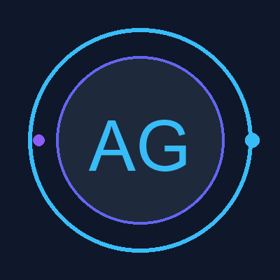

<div align="center">

  <!-- Animated Capsule Waving Banner -->
  

  <br/><br/>

  <!-- Animated Avatar & Greeting -->
  

  <h1>Hi , I'm <span style="color:#38bdf8;">Aahel Gupta</span>!</h1>

  <!-- Animated Typing SVG Header -->
  [](https://git.io/typing-svg)

  <br/><br/>

  <!-- Live Demo & Repo Badges -->
  <a href="https://aahelgupta.github.io/personal-portfolio/">
    
  </a>
  &nbsp;
  <a href="https://github.com/AahelGupta/personal-portfolio">
    
  </a>
  &nbsp;
  <a href="mailto:aahelgupta47@gmail.com">
    
  </a>

</div>

<br/>

---

## ⚡ Animated Effects Showcase

### 🌐 Animated Cyber Grid Perspective


<br/>

### 💚 Animated Matrix Code Rain


<br/>

### 🐍 Animated Contribution Graph Snake


---

## 🚀 How to Run Locally in VS Code

```bash
# 1. Open the project in VS Code
# 2. Open the terminal (Ctrl + `)
# 3. Run the development server:
npm run dev
```

The site will start at **`http://localhost:3000/`** and automatically open in your default browser!

---

## 🌟 Featured GitHub Web Projects Included

| # | Project | Tech Stack | Highlights | Link |
|---|---|---|---|:---:|
| 1 | **News-Aggregator** | `React 18` `Tailwind v4` `Vite` | Multi-source real-time news hub (Guardian, BBC, Hacker News), text-to-speech, offline caching | [Repository](https://github.com/AahelGupta/News-Aggregator) |
| 2 | **Recipe-Finder** | `React 18` `Tailwind v4` `Vite` | Interactive culinary platform with pantry matching and meal planner | [Repository](https://github.com/AahelGupta/Recipe-Finder) |
| 3 | **Social-Media** | `React 18` `Context API` `Tailwind` | Twitter/X clone with feeds, post creation, hashtag search, and dark mode | [Repository](https://github.com/AahelGupta/Social-Media) |
| 4 | **Code-Editor** | `HTML5` `CSS3` `JavaScript` | In-browser live frontend code editor with real-time preview | [Repository](https://github.com/AahelGupta/Code-Editor) |
| 5 | **Mini-Ecommerce** | `JavaScript` `CSS Flexbox` | Online storefront with product catalog and shopping cart | [Repository](https://github.com/AahelGupta/Mini-Ecommerce) |
| 6 | **Employee-And-Admin-Dashboard** | `JavaScript` `CSS Grid` | Role-based task delegation and tracking dashboard | [Repository](https://github.com/AahelGupta/Employee-And-Admin-Dashboard) |
| 7 | **airbnb-clone** | `JavaScript` `CSS3` | Responsive accommodation rental listing clone | [Repository](https://github.com/AahelGupta/airbnb-clone) |
| 8 | **Student-Management-System** | `Python` `Web UI` | Academic student dashboard with attendance records & authorization | [Repository](https://github.com/AahelGupta/Student-Management-System) |
| 9 | **UI-Project** | `JavaScript` `CSS3 Animations` | Component design system with responsive layouts | [Repository](https://github.com/AahelGupta/UI-Project) |

---

## 📋 Assignment Requirements Met

- ✅ **5 Sections:** Home, About Me, Skills, Projects, Contact.
- ✅ **Required HTML Elements:** Headings (`<h1>`–`<h4>`), paragraphs (`<p>`), hyperlinks (`<a>`), images (``), lists (`<ul>`, `<ol>`), tables (`<table>`), forms (`<form>`).
- ✅ **CSS Styling:** External stylesheet (`css/style.css`), color variables, Google Fonts typography, Flexbox, box model, and media query responsiveness.
- ✅ **Interactive Effects:** Animated avatar, waving hand, typing effect, cyber constellation grid canvas, cyber perspective grid, matrix rain, contribution snake, and card transitions.
